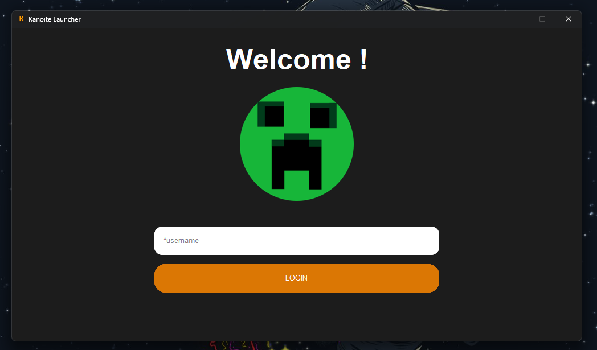
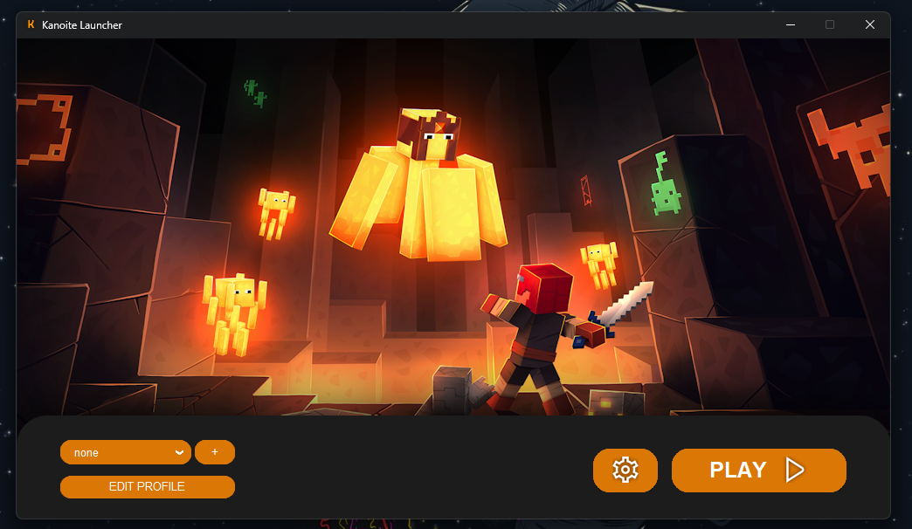
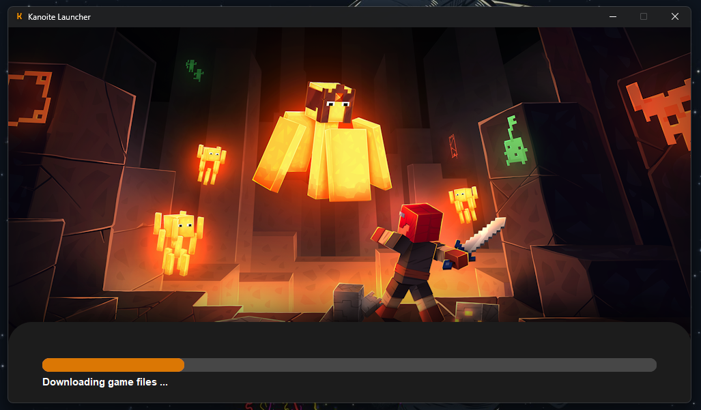
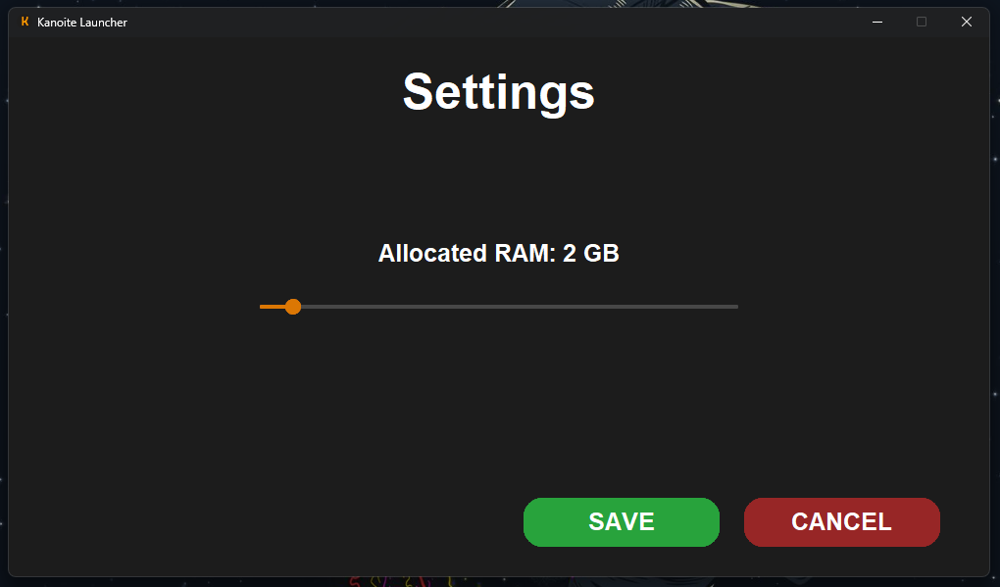
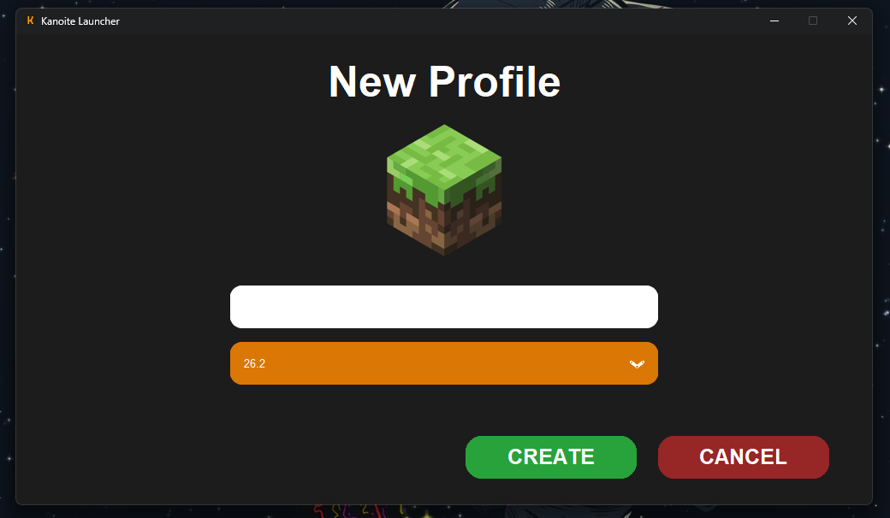
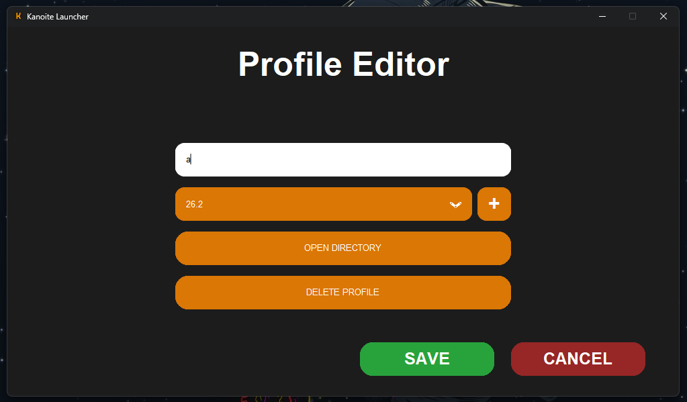

## 🔶 Kanoite Launcher : _Formerly Astro Launcher 2_

<p align="center">
  
</p>

<p align="center">
  
  
</p>

## 📖 Overview
A minecraft launcher written in python. It can run any version of the game, whether vanilla or modded.
The software is made to separate profiles made by the player. To make it simple, when you want to launch the game, you first need to create a profile with a name and a version. When this is done, you can launch it and all files will be isolated from your others profiles. If you use different texture packs or mods in different versions, every world is only accessible from the profile you used to create it.
### Features
| Feature | Implementation |
| :--- | :--- |
| **GUI** | ✅ |
| **Microsoft Authentication** | ✅ |
| **Profiles** | ✅ |
| **Customizable settings** | ✅ |
| **Discord Rich Presence** | ✅ |
| **Runtime Data Isolation** | ✅ |
#### Login page
</img>
#### Main Page
</img>
#### Loading animation
</img>
#### Settings page
</img>
#### Profile Managment pages
</img>
</img>

## 📜 Versions History
0.1, 0.2, and 0.3 : Added the profiling system

1.0 : Fixed bugs, added downloading label

1.1 : First refactoring, fixed bugs, GUI improvements

1.2 : Added RAM selection options, fixed bugs

1.3 : Total refactor to separate jobs

2.0 / 2.1 : Added turnkey official Microsoft account authentication (OAuth2 Device Code Flow, token refresh, Xbox Live & Minecraft Services integration)

## ⚙️ Installation & Usage
1. Install dependencies:
   ```bash
   pip install customtkinter minecraft-launcher-lib requests Pillow pypresence
   ```
2. Run the launcher:
   ```bash
   python app/main.py
   ```
3. Click **"SIGN IN WITH MICROSOFT"**, validate the displayed code on the Microsoft page, and start playing!
